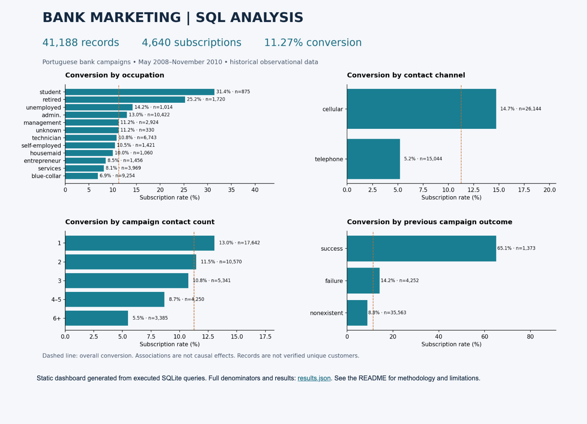

# Bank Marketing Analytics — MySQL Project

A MySQL 8 portfolio project examining which historical customer and campaign segments were associated with term-deposit subscriptions at a Portuguese bank.

## Business problem
How can a bank identify promising outreach opportunities and investigate inefficient campaign patterns? This project measures conversion, segments records, compares channels and contact frequency, and turns the findings into testable business recommendations.

## Dataset choice
Use **UCI Bank Marketing, `bank-additional-full.csv`**: 41,188 records, 20 input fields and one outcome, covering campaigns from May 2008 to November 2010. This is the full additional dataset, not the 4,119-row sample or the older 45,211-row bank-full version.

Your [Kaggle banking category](https://www.kaggle.com/datasets?tags=11129-Banking) is a discovery page. This project uses the [original UCI dataset](https://archive.ics.uci.edu/dataset/222/bank+marketing), rather than an unverified mirror, to make the version and license explicit. No Kaggle account is needed.

It is well suited to segmentation and marketing behavior. It does not include transaction histories, balances, revenue, or future repayment outcomes, so it cannot establish customer lifetime value, profitability, fraud, or predictive credit risk.

## Dashboard preview

Open [the static dashboard](dashboard/index.html) in a browser after downloading the repository. It works offline and shows four SQL-derived comparisons, sample sizes, and the overall conversion baseline. The image above is an actual browser capture. The dashboard is a static report, with no filters.

## Results
| Finding | Evidence | Business interpretation |
|---|---|---|
| Overall conversion | 4,640 / 41,188 = **11.27%** | Baseline for segment comparison |
| Previous campaign success | 894 / 1,373 = **65.11%** | Strong candidate for a controlled re-engagement test |
| Student segment | 275 / 875 = **31.43%**, 2.79× baseline | High observed rate, relatively small segment |
| Retired segment | 434 / 1,720 = **25.23%**, 2.24× baseline | Explore suitable outreach, subject to eligibility and fairness review |
| Cellular vs telephone | **14.74%** vs **5.23%** | Investigate channel mix with a randomized test |
| One vs six-plus campaign contacts | **13.04%** vs **5.49%** | Investigate repeated-contact policy; do not infer a causal contact limit |

Rates measure records, not verified unique customers. These are historical associations and do not demonstrate that changing a channel or contact policy causes an improvement.

## What we did and how
1. Preserved the original semicolon-delimited CSV and source documentation.
2. Loaded all 21 fields into a typed table. A synthetic `record_id` tracks source rows; it is not a customer ID. Renamed dotted fields to underscores and `default` to `credit_default`.
3. Created a SQL view with a binary subscription flag, age bands, and contact-count bands. Kept `unknown` categories and the `pdays=999` sentinel instead of treating them as normal known values.
4. Executed 11 analysis queries using conditional aggregation, CASE, CTEs, subqueries, and a DENSE_RANK window function. Exported every query result to CSV.
5. Compared channel conversion within previous-campaign outcome strata to explore confounding. For previous-success records, cellular converts at 65.20% and telephone at 64.08%, much closer than the overall comparison.
6. Identified exploratory job/channel/history combinations with at least 100 records. This support threshold reduces tiny-group noise; it does not provide statistical validation.
7. Included the original SQL-derived dashboard and result CSVs as reference outputs. The converted MySQL scripts still require local execution; see validation notes below.

## Run locally with MySQL

Use **MySQL Server 8.0+** and MySQL Workbench. No Python is required:

1. Run `mysql/00_setup.sql`.
2. Run `mysql/01_import_data.sql` to load all 41,188 records.
3. Run `mysql/03_validate.sql`; all six checks should equal 1.
4. Run `mysql/02_analysis.sql` for all 11 analyses.

See [MYSQL_SETUP.md](MYSQL_SETUP.md) for click-by-click instructions and troubleshooting. See [MySQL validation](reports/mysql_validation.md) for execution evidence.

## Repository contents
- `data/`: original CSV, original field definitions, and a concise data dictionary.
- `mysql/`: MySQL setup, bundled data import, 11 analyses, and validation checks.
- `reports/results/`: complete query outputs, including denominators.
- `reports/business_insights.md`: interpretation, proposed experiments, and limitations.
- `reports/validation.json`: input SHA-256, row count, duplicate surplus, database integrity.
- `dashboard/`: offline HTML, chart image, browser screenshot, and result JSON.

## Data quality and interpretation
- 12 exact repeated-row surplus records are retained because identical attributes do not prove duplicate customers.
- 8,597 default statuses are `unknown`; do not interpret them as no default. Only three records have default=`yes`, making default-group conclusions unreliable.
- 39,673 records have `pdays=999`, meaning no prior campaign contact. Do not average 999 as elapsed days.
- No customer identifier, year, or complete date is provided. Month results pool years; no monthly trend or retention analysis is claimed.
- Call duration is known after a call, and final campaign contact counts are retrospective. Do not use either to claim a pre-call targeting model.
- Successful subscriptions may stop further calls, so lower conversion in high-contact groups can reflect stopping behavior and selection.
- No causal inference, predictive model, statistical significance, or realized revenue lift is claimed. Validate candidates on fresh data before deployment.

## Validation status

All 41,188 emitted import records were compared field by field with the source-derived data, and repeat-import behavior was checked. End-to-end execution against MySQL remains unverified. Run the validation SQL locally; all six flags should equal 1. The dashboard and CSVs are reference snapshots from the original analysis, not verified MySQL exports.

## Publish on GitHub
Create an empty repository named `bank-marketing-sql-analysis`, upload this folder's contents, and keep the directory structure intact so the README image renders. Suggested description: “SQL analysis of 41,188 bank marketing records with customer segmentation, campaign insights, and an offline dashboard.”

The project is prepared for upload; it has not been published to a GitHub account.

## Attribution and licensing
Dataset: Moro, S., Rita, P., & Cortez, P. (2014). *Bank Marketing*. UCI Machine Learning Repository. [DOI: 10.24432/C5K306](https://doi.org/10.24432/C5K306). Data is licensed under [CC BY 4.0](https://creativecommons.org/licenses/by/4.0/). Original CSV is unchanged; normalized data and aggregates are derived works. See [ATTRIBUTION.md](ATTRIBUTION.md). Project code is provided under the MIT license in [LICENSE](LICENSE).
