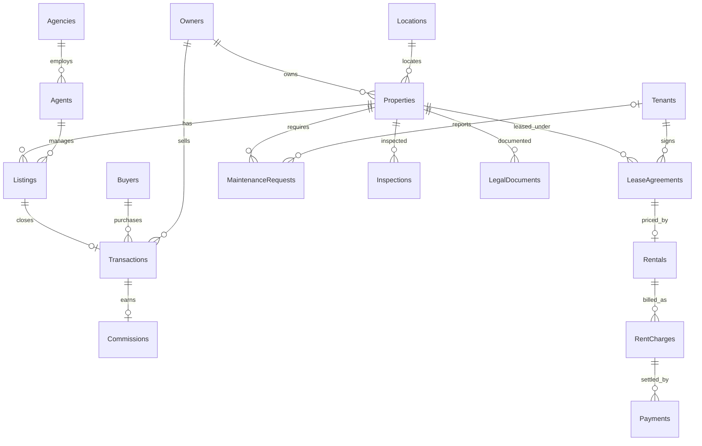

# Current database relationships

Each property is an individually rentable asset. Lease intervals use an exclusive end date.
A charge represents one rental billing period. Multiple payment rows support partial settlement;
each payment belongs to exactly one charge. A sale references its listing, which determines its
property and agent. Seller identity is stored separately to preserve the historical seller.
One commission record per sale is supported; commission splits are outside this demo's scope.

The two root-level PDFs describe the original group coursework, not this revised schema.
